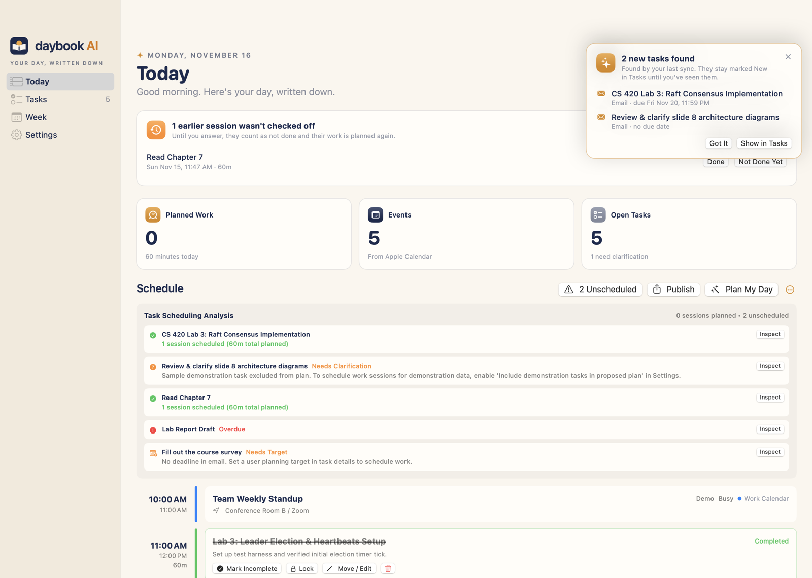
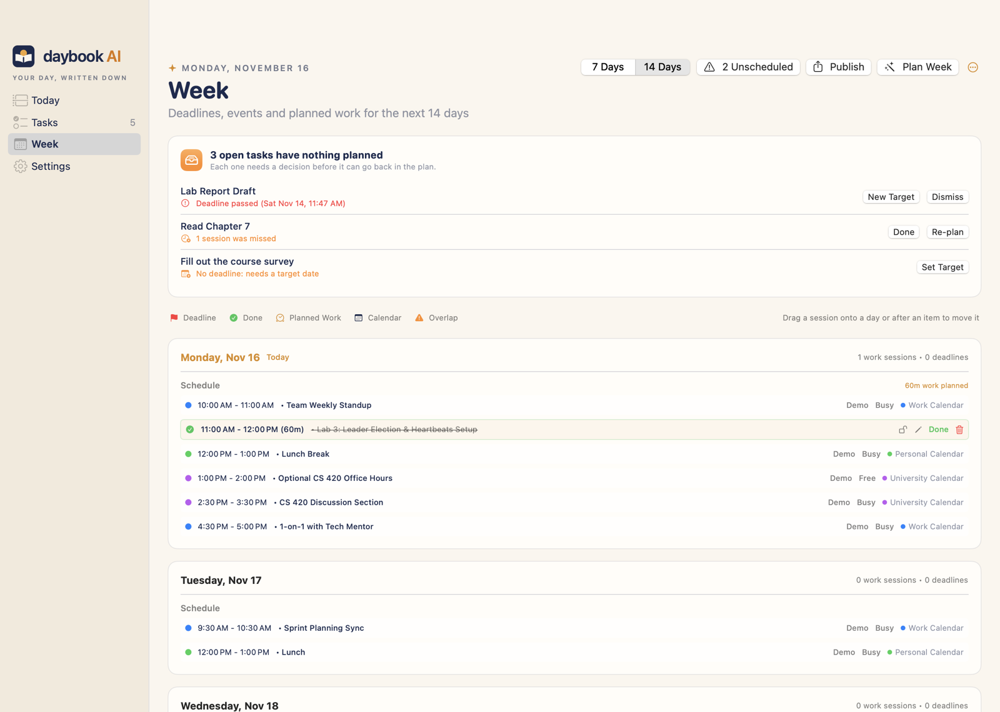
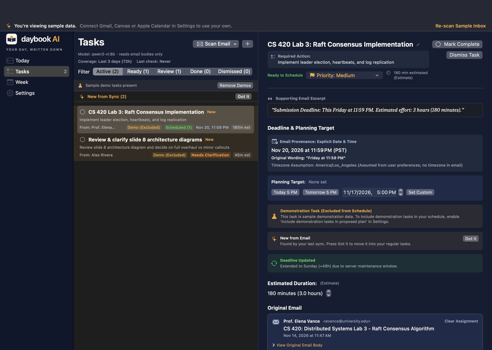

# DayBook AI

**Your day, written down.** A native macOS planner for students. DayBook AI finds tasks in your Canvas courses, Gradescope and Gmail, then plans focused work sessions around your Apple Calendar, so every assignment gets time before it's due.

All AI runs on your own Mac through [Ollama](https://ollama.com). There is no account, no cloud service, no API key and no cost.



## What it does

- **Finds your work.** Reads due dates and submission status from Canvas, assignments from Gradescope, and tasks from the last 72 hours of your Gmail inbox. Announcements, messages and emails are read by a local AI model. Quick Capture turns pasted text or a screenshot into a task.
- **Plans your time.** Fits work sessions into your working hours, around calendar events, lunch and breaks, with a daily cap. Urgent work and anything you didn't finish come first; after that, whatever has the least spare time before its deadline. Each task is tagged *Start now*, *Start soon*, *On track* or *Won't fit*.
- **Estimates from what's actually asked.** The local model reads each assignment's instructions, rubric and attached PDF or Word files, breaks the work into parts and adds them up. Estimates made from a title alone are marked *Check Estimate*. When you finish a task, Today asks how long it really took, and later estimates for that course adjust to your pace.
- **Keeps the plan honest.** A session you didn't check off counts as not done, and its work is planned again. Today asks *Done* or *Not Done Yet*. Week lists every open task with nothing planned and how to fix it (set a target, raise priority, change the estimate, re-plan).
- **Stays in sync.** One **Sync Everything** button (and automatic runs at 8 AM, 1 PM and 6 PM) reads Calendar, Canvas, Gradescope and email, then re-plans and tells you what changed. New tasks are highlighted until you've seen them. The same assignment from two places becomes one task, never a duplicate.
- **You stay in charge.** Drag sessions between days, lock them, delete them (later sessions move up), or edit them. Planned sessions stay inside the app until you choose **Publish**, which writes them to a separate "DayBook AI" calendar.

| Week | Tasks |
| --- | --- |
|  |  |

## Requirements

- A Mac with Apple silicon, running macOS 14 Sonoma or later
- Apple's Command Line Tools (to build): `xcode-select --install`
- [Ollama](https://ollama.com/download) with a model. The default is `qwen3-vl:8b` (about 6 GB), which can also read screenshots. Text-only models such as `qwen3:8b` work too; text in images is then read on your Mac first.

## Install

```bash
git clone https://github.com/gielsss/DayBook-AI.git
cd DayBook-AI
ollama pull qwen3-vl:8b
./scripts/run.sh
```

`run.sh` builds `build/DayBook AI.app` and opens it. To keep it, drag the app into Applications.

The app opens with sample data, so you can look around before connecting anything. Settings → **Remove All Demonstration Tasks** clears it.

**Notes**
- The build is signed ad hoc on your Mac, so macOS doesn't block it. If you have a code-signing certificate, `build.sh` uses it.
- After each rebuild, macOS may ask once whether DayBook AI can use its saved Keychain items. Choose **Always Allow**.

## Connect your accounts

Everything is optional. Use only what you need; all of it is under **Settings**.

### Apple Calendar
Settings → Apple Calendar → **Connect Apple Calendar**, and allow access. DayBook AI reads your events to plan around them. It only writes to its own "DayBook AI" calendar, and only when you press Publish.

### Canvas
Settings → Canvas. Enter your school's Canvas address (for example `canvas.yourschool.edu`) and choose how to connect:

- **Browser tab (works with single sign-on):** sign in to Canvas in Safari, Chrome or Arc, keep the tab open, and press **Find my Canvas tab**. macOS asks once whether DayBook AI may control that browser. DayBook AI reads Canvas through that tab and stores no password or cookies.
- **Sign in inside the app:** a Canvas sign-in window opens. The sign-in is saved in your Keychain.
- **Access token:** create one in Canvas → Account → Settings → New Access Token, and paste it in.

DayBook AI only reads from Canvas. It never submits or changes anything.

### Gradescope
Sign in to Gradescope in Safari, Chrome or Arc, then Settings → Gradescope → **Find my Gradescope tab**. Your current term's student courses are read from that tab.

### Gmail
Google requires each user to bring their own sign-in settings for apps like this one. Do this once:

1. In the [Google Cloud console](https://console.cloud.google.com/), create a project and enable the **Gmail API**.
2. Under **Google Auth Platform** (OAuth consent screen), choose **External**, fill in the app name and your email, and add yourself under **Test users**.
3. Under **Clients**, create an OAuth client of type **Desktop app**, then download its JSON file.
4. In DayBook AI: Settings → Gmail → **Import Google OAuth Client Credentials** (choose or paste the JSON file), then **Sign in with Google**.

DayBook AI asks only for read-only Gmail access (`gmail.readonly`) and looks at your Inbox from the last 72 hours. Emails it has already read are never sent to the model again.

## Privacy

- Your planner lives in `~/Library/Application Support/PersonalPlanner/` (the app's earlier name), with daily backups of the last 14 days in a `Backups` folder there. These files aren't encrypted by the app; they're protected by your macOS account (and FileVault, if it's on).
- Tokens, cookies and Google credentials are stored in your macOS Keychain, never in files or logs, and aren't synced to iCloud.
- Email text, Canvas messages, attached files and screenshots are sent only to Ollama on your Mac. The app refuses to send them to any other address unless it's https.
- Canvas requests go only to your Canvas site over https; a sign-in token or cookie is never passed to another site. Attached files are downloaded with the link Canvas provides, without cookies, and never saved.
- Gmail access is read-only. Google sign-in uses PKCE and listens only on this Mac for the reply.
- The app makes no other network requests besides Canvas, Gradescope and Google, and only when you've connected them. There is no analytics or tracking.

## Development

```bash
./scripts/build.sh                       # build build/DayBook AI.app
APP="./build/DayBook AI.app/Contents/MacOS/DayBookAI"
"$APP" --test-persistence                # saving, loading and planning rules
"$APP" --test-milestone-improvements     # scheduling, carryover, early completion
"$APP" --test-canvas                     # Canvas, Gradescope, sync and task memory
"$APP" --test-email-discovery            # Gmail scanning and caching
"$APP" --test-ollama                     # local AI requests (no Ollama needed)
"$APP" --test-quick-capture              # Quick Capture
"$APP" --render-ui /tmp/daybook-ui       # screenshots of every tab, light and dark
```

The test suites work offline against stand-ins for Canvas, Ollama and the calendar, and use temporary folders. The source and bundle still use the original name, PersonalPlanner, so existing data and Keychain items carry over.

## Disclaimer

DayBook AI is an independent project, not affiliated with or endorsed by Instructure (Canvas), Gradescope/Turnitin, Google or Apple. Reading Canvas and Gradescope through your browser uses your own signed-in session; check that this is allowed at your school. Always confirm deadlines in the original course site: an AI model can misread a date.

## License

[MIT](LICENSE)
